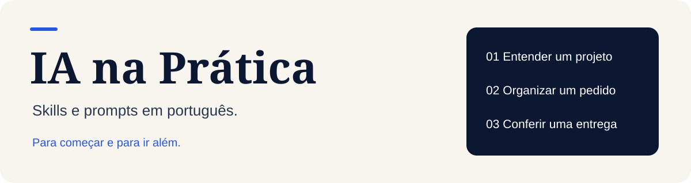

<p align="center">
  
</p>

# IA na Prática

**Skills, prompts e guias em português para trabalhar com IA, mesmo sem saber programar.**

Escolha uma tarefa, copie o pedido e confira o resultado. Há um caminho sem instalação para começar e recursos técnicos para quem já usa agentes com acesso a arquivos.

[Comece aqui](guias/comece-aqui.md) · [Skills](#skills-da-coleção) · [Fontes públicas](recursos/fontes.md) · [Card para compartilhar](divulgacao/README.md)

## O que você quer fazer?

| Preciso de ajuda para… | Abra este material | O que esperar |
| --- | --- | --- |
| Entender uma pasta ou projeto | [Entender um projeto](prompts/entender-projeto.md) | Explicação simples do que existe e do que ainda é desconhecido. |
| Transformar uma ideia em um pedido claro | [Organizar um pedido](prompts/organizar-pedido.md) | Objetivo, limites e um jeito de conferir a entrega. |
| Saber se uma entrega está pronta | [Conferir uma entrega](prompts/conferir-entrega.md) | Comparação entre o pedido, o resultado e as evidências disponíveis. |
| Escolher entre ferramentas ou propostas | [Comparar opções](prompts/comparar-opcoes.md) | Critérios, fontes e custos conhecidos, sem notas inventadas. |
| Avaliar segurança e atualizações | [Guia de auditoria](guias/auditoria-seguranca.md) | Roteiro técnico com a skill da Cloudflare e validação dos achados. |

**Primeira vez aqui?** Comece por organizar um pedido. Não exige terminal, instalação nem acesso ao seu computador.

## Experimente agora

Copie o texto abaixo para a conversa com a IA e troque o que está entre colchetes:

```text
Ajude a transformar esta ideia em um pedido claro: [descreva a ideia].
Quem vai usar: [público]. O resultado esperado: [resultado].
Limites: [prazo, orçamento e o que não pode mudar; ou "a definir"].
Não execute a tarefa ainda. Organize o objetivo, a menor entrega útil
e como conferir se funcionou. Separe fatos, suposições e dúvidas.
Pergunte apenas o que realmente impedir uma proposta útil.
```

Exemplo: organizar os pedidos de uma pequena loja que hoje chegam por mensagens. O primeiro resultado pode ser um modelo de registro dos pedidos; a necessidade de criar um aplicativo depende do problema observado.

## Skills da coleção

Uma **skill** é um conjunto de instruções reutilizáveis que um agente compatível pode carregar. Um **prompt** é o pedido que você cola na conversa. Instalar skills é opcional para usar os prompts desta coleção.

| Skill | Quando usar | Exemplo de pedido |
| --- | --- | --- |
| [explicar-projeto](skills/explicar-projeto/SKILL.md) | Entender um projeto sem receber uma lista de termos técnicos. | “Explique esta pasta para quem cuida do negócio.” |
| [organizar-pedido](skills/organizar-pedido/SKILL.md) | Preparar uma tarefa com limites e resultado verificável. | “Transforme esta ideia em um pedido para a equipe.” |
| [conferir-entrega](skills/conferir-entrega/SKILL.md) | Comparar uma entrega com o combinado e apontar o que falta comprovar. | “Confira se o material atende ao pedido.” |

[Como instalar uma skill](guias/instalar-skills.md). O formato foi validado; o comportamento precisa ser conferido no agente e no contexto em que será usado. As skills não concedem acesso a arquivos nem permissões adicionais.

## Segurança: uma trilha para o responsável técnico

O [prompt de auditoria](PROMPT.md) orienta o uso da **security-audit da Cloudflare**. Ele pede evidências, separa hipóteses de falhas demonstradas e preserva os limites de execução da skill oficial. A instalação sozinha não realiza uma auditoria.

Quem não programa pode usar o [guia](guias/auditoria-seguranca.md) para entender o resultado e encaminhar o roteiro a quem mantém o sistema. Testes de segurança e mudanças em produção exigem capacidade técnica e autorização específica.

As [fontes comentadas](recursos/fontes.md) explicam o que cada referência sustenta: método da Cloudflare, avisos do Node.js, documentação do npm e a campanha de outubro do NIST. Não há diagnósticos de sistemas particulares nesta coleção.

## Referências e autoria

A organização por objetivos tem como referência o [Vibe Coding Toolkit, de Matheus Gomes](https://github.com/soumatheusgomes/vibe-coding-toolkit). Os materiais desta coleção foram escritos para este repositório; não são uma cópia do toolkit nem uma publicação oficial dos fornecedores citados.

Recursos de terceiros são indicados por links para a origem, com requisitos e limites. Consulte a licença de cada projeto antes de redistribuir seu conteúdo.

## Contribuir e compartilhar

Sugestões de melhoria são bem-vindas: [como contribuir](CONTRIBUTING.md). Use exemplos fictícios, com um objetivo que outra pessoa consiga entender e conferir.

[Card e legenda](divulgacao/README.md) · [Licença MIT](LICENSE)
